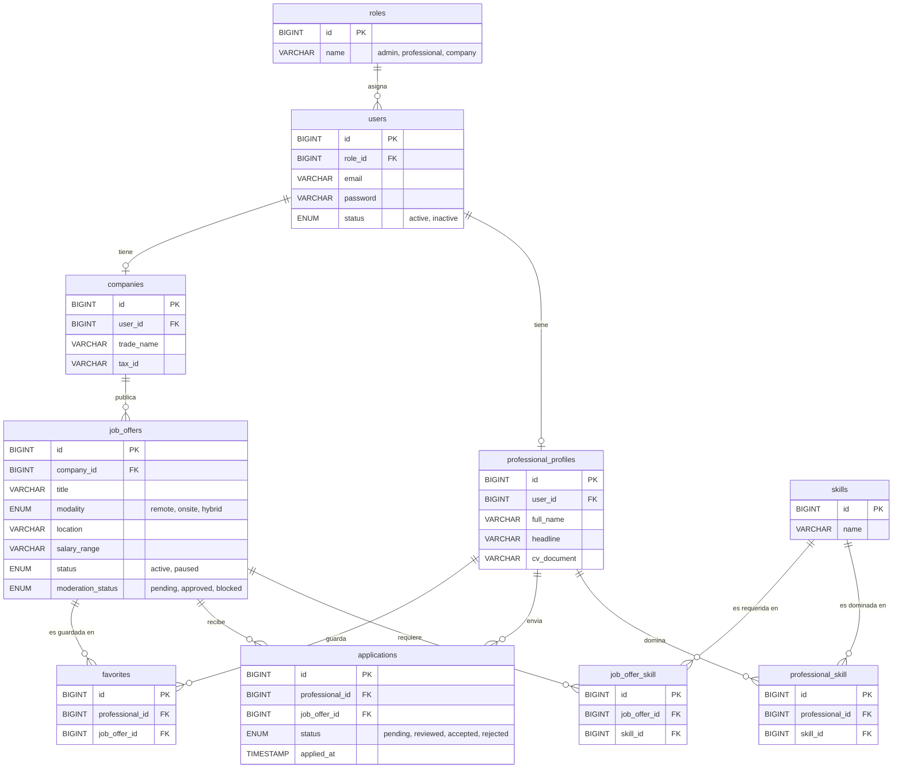

# Modelo de datos de CareerTrack

## Correcciones aplicadas
1. **`roles` relacionada a `users`:** el rol deja de ser un ENUM y pasa a ser una tabla con `users.role_id`.
2. **Un profesional tiene muchas skills:** nueva tabla pivote `professional_skill`.
3. **Estados de `job_offers` separados:** `status` (lo controla la empresa: `active`, `paused`) y `moderation_status` (lo controla el administrador: `pending`, `approved`, `blocked`).
4. **Campos que pedían las pantallas:** `professional_profiles.headline` (titular/cargo) y `job_offers.location`.
5. **Integridad:** índices únicos en `applications`, `favorites` y las pivotes de skills, para evitar duplicados (un profesional no se postula dos veces a la misma oferta).
6. **Rendimiento:** índice compuesto `job_offers(status, moderation_status)` e índices en las llaves foráneas de las pivotes.
7. **Baja lógica:** `users.status = inactive` bloquea el acceso sin borrar el historial.
